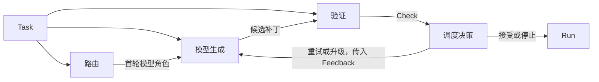

# I1 共享接口与分页修复示例

I1 定义路由、模型调用、补丁验证和调度的交接格式。组员可用同一份 `Task` 和分页样例开发各自的模块。共享类型位于 `hybrid_inference/contracts.py`，使用 Python dataclass 和可调用接口。

## 请求如何流转

| 模块 | 共享接口 | 负责的决策 |
| --- | --- | --- |
| 路由 | `Router(task) → Route` | 给出首轮的 `fast` 或 `strong`，并返回分数、阈值和可选的 `reason`。调度器只用 `Route.model` 启动首轮，完整路由保存在 `Run.route`。 |
| 模型 | `Model(task, feedback) → ModelReply` | 首轮 `feedback` 为 `None`。后续使用上一轮候选和验证摘要生成完整补丁。模型标识、停止原因和可用的 Token 用量独立返回。服务调用异常通过 `ModelError` 表示。 |
| 验证 | `PatchVerifier(task, patch) → Check` | 将补丁应用到任务基线，并运行任务指定的检查。输出通过状态、稳定的失败代码和可反馈给模型的摘要。 |
| 调度 | `run_task(task, router=..., models=..., verify=...) → Run` | 根据路由启动首轮，根据当前和上一轮检查结果决定接受、重试、升级或停止。`Run.attempts` 保存每轮角色、验证结果和决策原因。 |

`run_task` 的 `verify` 参数当前接收单参数回调。集成补丁验证器时传入 `verify=partial(patch_verifier, task)`，使分页示例和已有的候选文本演示共用调度器。

## 编码任务首轮路由

`CodingTaskRouter` 使用无需模型调用的启发式规则，基础分为 25 点：

| 信号 | 加分 |
| --- | --- |
| `allowed_paths` 中不同的可修改路径数 | 从第二条路径起每条加 25 点，最多加 50 点 |
| `files` 中提供的源码总行数（含只读上下文） | 至多 200 行不加分，201–500 行加 25 点，超过 500 行加 50 点 |

总分封顶 100 点，再除以 100。分数达到阈值时选 `strong`，否则选 `fast`。`Route.reason` 记录两项信号的实际值和加分。缺少可修改路径或源码快照时，退回调用方提供的 `Task.difficulty`，并记录退回原因。旧的 `ThresholdRouter` 仍可直接使用人工分数。文件数和行数只是修改范围和阅读量的代理，不代表修复的真实难度；后续可根据样例结果校准。

## 编码任务的约定

- `Task` 的 `task_id` 用于标识任务。`base_revision` 标识候选补丁所针对的固定源码版本，在本例中取样例版本 `pagination-v1`。`files` 提供模型要读取的源码快照，`allowed_paths` 列出允许修改的相对路径，`check_ids` 列出应运行的检查标识。
- 编码任务的 `ModelReply.text` 存放原始 unified diff。每轮候选都针对同一份基线。修订时，模型读取上一轮补丁和反馈，返回覆盖本轮全部修改的完整补丁。
- 每次验证都从一份干净的基线开始。通用验证器负责限制补丁允许修改的文件，并把 `check_ids` 映射到已配置的检查。此版分页演示只接收两份随仓库提供的补丁，使用本地 Git 和 Python 运行检查。

| `Check.kind` | 含义 | 调度行为 |
| --- | --- | --- |
| `None` | 成功时 `passed=True`。已有文本验证器也可省略 `kind`。 | 成功即接受。旧验证器失败时仍按 `code` 比较。 |
| `candidate_error` | 候选没有可用输出，或补丁格式、范围、应用有问题。 | 快模型可重试或升级，强模型失败后停止。 |
| `test_failed` | 检查已执行，候选未满足要求。 | 快模型可重试或升级，强模型失败后停止。 |
| `environment_error` | 验证工具或环境无法执行检查。 | 停止并返回 `verification_error`。 |

在快模型仍有尝试次数时，反馈策略比较相邻两次失败的 `(kind, code)`。测试失败的 `code` 可由排序后的测试标识组成。`summary` 用来帮助模型修订，可以描述预期结果和实际问题。

## 分页样例与验收

`paginate(items, page, page_size)` 使用从 1 开始的页码，允许末页不足一页，越界页返回空列表，`page` 或 `page_size` 小于 1 时抛出 `ValueError`。基线同时存在偏移错误和参数校验缺失。

在项目根目录运行 `python3 -m examples.pagination.demo`。分页只允许修改一个文件，源码也不超过 200 行，所以估分为 0.25，低于默认阈值 0.7，进入快模型。快模型使用 `partial.patch` 修复偏移，真实检查仍报告 `test_invalid_page` 和 `test_invalid_page_size`。第二轮快模型使用同一份补丁，调度器据重复失败升级。强模型使用 `complete.patch`，全部检查通过。`examples/pagination/expected_trace.json` 保存可比较的预期轨迹。

运行 `python3 -m examples.pagination.demo --threshold 0.25`，同一任务的分数恰好达到阈值，直接进入强模型并一轮通过，无需重试或升级。

运行 `python3 -m unittest discover -s tests -v` 可验证该轨迹和原型的其他行为。组员可以按表中接口替换各自的实现，再由负责人对共享样例做集成验收。
